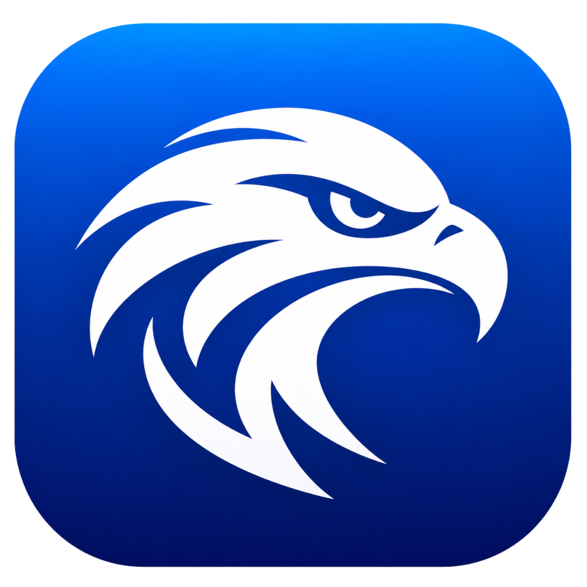
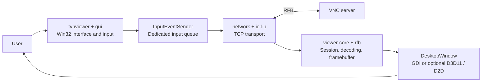

<p align="center">
  
</p>

<h1 align="center">FarSightVNC</h1>

<p align="center">
  A native Windows VNC viewer, built on TightVNC and refined for everyday remote work.
</p>

<p align="center">
  
  
  
  
  <a href="wix-installer/LICENSE.txt"></a>
</p>

<p align="center">
  <a href="#what-is-farsightvnc">About</a> ·
  <a href="#highlights">Highlights</a> ·
  <a href="#getting-started">Getting started</a> ·
  <a href="#architecture">Architecture</a> ·
  <a href="#building-from-source">Build</a> ·
  <a href="#license-and-credits">License</a>
</p>

## What is FarSightVNC?

FarSightVNC is a **fork of TightVNC 2.8.90**, focused on improving the Windows Viewer: keyboard handling, display scaling, input responsiveness, connection management and stability.

It keeps the native C++/Win32 foundation and RFB protocol implementation of TightVNC, with targeted changes rather than a rewrite. The repository also retains the upstream server, shared libraries and installer projects; FarSightVNC development currently centers on the **Viewer**.

**Current version: v0.1.2a (alpha).** Features and behavior are still evolving. The original TightVNC version remains the upstream baseline, separate from FarSightVNC's own version number. See [MODIFICATIONS.md](MODIFICATIONS.md) for the dated modification history.

## Highlights

| Area | What FarSightVNC adds |
| --- | --- |
| **Keyboard** | Physical key tracking, balanced key releases, dead-key and AltGr handling, and fixes for ABNT2 and US-International layouts. System shortcuts can be forwarded while the connected Viewer window is active, including in windowed mode. |
| **Display** | Per-monitor DPI handling, scaling based on the remote framebuffer, monitor selection for full screen and horizontal mouse-wheel support. Sessions start scaled to the window. |
| **Responsiveness** | A dedicated input-sending thread keeps network writes off the UI thread. Ordered input delivery and `TCP_NODELAY` address avoidable input delays. |
| **Rendering** | GDI by default, with an optional Direct3D 11 / Direct2D presentation path for GPU scaling and automatic fallback to GDI. |
| **Everyday use** | Tabbed connection options, favorite hosts, recent connections, a floating full-screen toolbar and assisted reconnection with bounded retries. |
| **Stability** | zlib 1.3.2, decoder fuzzing tools, a framebuffer bounds fix and regression harnesses for input, rendering and connection behavior. |

The Viewer also retains TightVNC capabilities such as multiple RFB encodings, view-only sessions, clipboard exchange and file transfer where supported by the server.

## Getting started

You need a running VNC server and a built Viewer executable. To build your own, follow [Building from source](#building-from-source).

Launch `tvnviewer.exe`, enter the server address and connect. The executable keeps its upstream filename even though the application is branded FarSightVNC.

```powershell
# Open the connection dialog
.\build\bin\x64\Release\tvnviewer.exe

# Connect using an explicit TCP port (double colon)
.\build\bin\x64\Release\tvnviewer.exe 192.168.1.20::5900

# Try the optional GPU presentation path
.\build\bin\x64\Release\tvnviewer.exe -renderer=gpu 192.168.1.20::5900
```

Renderer modes are `gdi`, `auto` and `gpu`. **GDI is the default**; GPU presentation does not move RFB decoding to the GPU. See [RenderSettings.h](tvnviewer/RenderSettings.h) for mode selection and configuration sources.

### Connection security

The current Viewer has **no native TLS/VeNCrypt support**. For remote access across untrusted networks, use an SSH tunnel or VPN; VNC authentication alone does not encrypt the session.

The repository includes a [secure connection guide](docs/seguranca/tunel-ssh-vpn.md) and a [VeNCrypt assessment](docs/seguranca/avaliacao-vencrypt.md), both in Portuguese.

## Architecture

FarSightVNC is a native C++ desktop application. Win32 windows and dialogs handle the interface, the Viewer core manages the RFB session, and shared libraries provide transport, framebuffer operations, configuration and platform services.



The diagram shows the main session paths; configuration, file transfer and platform helpers support these components.

| Directory | Responsibility |
| --- | --- |
| [`tvnviewer/`](tvnviewer/) | Application entry point, connection windows, keyboard integration, scaling, full-screen UI and presentation. |
| [`viewer-core/`](viewer-core/) | Client session lifecycle, authentication, incoming RFB messages and queued outgoing input. |
| [`rfb/`](rfb/) | Shared RFB definitions, keysyms, framebuffer primitives and encoding support. |
| [`network/`](network/), [`io-lib/`](io-lib/) | Sockets and stream I/O. |
| [`gui/`](gui/), [`win-system/`](win-system/) | Native UI helpers, DPI utilities, keyboard hooks and Windows integration. |
| [`client-config-lib/`](client-config-lib/), [`config-lib/`](config-lib/) | Viewer options, favorites, connection history and configuration infrastructure. |
| [`ft-client-lib/`](ft-client-lib/), [`ft-common/`](ft-common/) | Client-side file transfer and shared transfer protocol code. |
| [`zlib/`](zlib/), [`libjpeg/`](libjpeg/) | Bundled compression and JPEG dependencies. |
| `tvnserver/`, `tvnserver-app/`, `rfb-sconn/` | Retained upstream server implementation. |
| [`tools/`](tools/), [`docs/`](docs/) | Build scripts, test servers, regression tools, measurements and engineering reports. |

For compatibility, much of the Viewer configuration still uses `HKCU\Software\TightVNC\Viewer`. FarSightVNC favorites use the separate `HKCU\Software\FarSightVNC\Viewer\Favorites` key.

## Building from source

### Prerequisites

- Windows with Visual Studio or Visual Studio Build Tools and the **Desktop development with C++** workload.
- **MSVC v145** and a **Windows 10/11 SDK**, as required by the current project files.
- PowerShell for the build and test scripts.
- Python 3 for the Python-based test servers and probes; it is not required to run the Viewer.

Windows XP is no longer a supported build target.

From the repository root:

```powershell
# Build the Viewer and its dependencies: Release, 64-bit
.\tools\build.ps1 -Configurations Release -Platforms x64

# Build the default matrix: Release + Debug, x64 + Win32
.\tools\build.ps1
```

The script locates MSBuild through `vswhere` and builds the `tvnviewer` target in **`tightvnc2017.sln`**. The solution retains its upstream name; its projects have been retargeted to the toolchain above. You can also open it in Visual Studio.

| Configuration | Viewer output |
| --- | --- |
| Release / x64 | `build\bin\x64\Release\tvnviewer.exe` |
| Debug / x64 | `build\bin\x64\Debug\tvnviewer.exe` |
| Release / Win32 | `build\bin\Win32\Release\tvnviewer.exe` |
| Debug / Win32 | `build\bin\Win32\Debug\tvnviewer.exe` |

Build logs are written to `build-logs/`.

## Testing

The repository includes native regression projects and integration scripts. Choose the checks relevant to your change; GUI and GPU checks require an interactive Windows session.

```powershell
# Build and run the keyboard regression executable
.\tools\build.ps1 -Project viewer-keyboard-test -Configurations Release -Platforms x64
.\build\bin\x64\Release\viewer-keyboard-test.exe

# Keyboard end-to-end check against a local recording RFB server (Python 3)
.\tools\keyboard-e2e-test.ps1 -Viewer .\build\bin\x64\Release\tvnviewer.exe

# GPU presenter regression check (requires an existing Release/x64 build)
.\tools\gpu-presenter-test.ps1

# Decoder bounds regressions against a local fuzzing server (Python 3)
.\tools\fuzz-test.ps1 -Regression -Viewer .\build\bin\x64\Release\tvnviewer.exe
```

Additional projects cover input queue behavior (`viewer-input-queue-test`), keysyms (`viewer-keysym-test`) and favorites, toolbar and reconnection policies (`viewer-favorites-test`). Other scripts cover real-input keyboard checks, DPI/display behavior, connection smoke tests, latency measurements and long-running sessions.

See [`tools/`](tools/) for parameters and prerequisites, and [`docs/reports/`](docs/reports/) for recorded results and limitations. Historical reports describe their tested revisions, not a guarantee for every later build.

## Contributing

Issues and focused pull requests are welcome. For bug reports, include the FarSightVNC version, Windows version, server implementation/version and steps to reproduce. For keyboard or display issues, also include the keyboard layout, DPI settings and renderer mode.

Keep changes aligned with the existing C++/Win32 structure, preserve upstream copyright and license notices, and document modifications in [MODIFICATIONS.md](MODIFICATIONS.md). Run the relevant regression checks and report what was tested.

FarSightVNC versions follow `vMAJOR.MINOR.FIX` with an optional `a` (alpha) or `b` (beta) suffix. Shipped builds increment the appropriate version component; the Windows version resource lives in [`tvnviewer/tvnviewer.rc`](tvnviewer/tvnviewer.rc).

## License and credits

FarSightVNC is distributed under the **GNU General Public License, version 2 or (at your option) any later version** (`GPL-2.0-or-later`). The full license is included in [`wix-installer/LICENSE.txt`](wix-installer/LICENSE.txt).

This project is derived from **[TightVNC](https://www.tightvnc.com/) 2.8.90**, Copyright © GlavSoft LLC and the respective upstream contributors. FarSightVNC modifications are credited to the FarSightVNC contributors. Original copyright and license notices are preserved; the fork's changes are documented in [MODIFICATIONS.md](MODIFICATIONS.md).

Bundled third-party components retain their own license terms:

- **zlib** — see [`zlib/LICENSE`](zlib/LICENSE).
- **Independent JPEG Group's JPEG library** — see the **LEGAL ISSUES** section of [`libjpeg/README`](libjpeg/README).

The software is provided **without warranty**, as described in the license. Thanks to the TightVNC authors and the open-source projects that make this fork possible.
